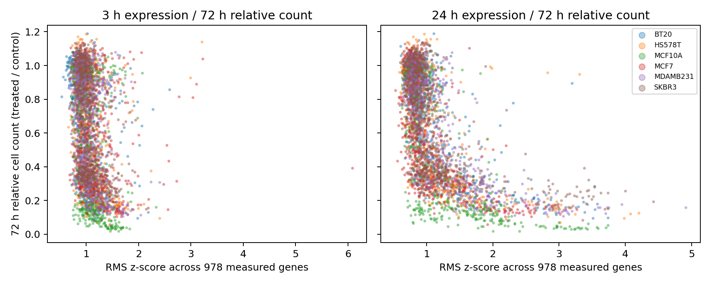

# 已下载数据检查与可行性分析（2026-11-06）

阅读提示：本报告的8,337条签名及相关分析属于第一版较宽条件候选。后续已按HMS实际库板核对并形成[v2产物](../integration_20261106/v2_库板来源核对/README.md)，当前状态见[详细进度说明](../investigation_20261106/当前对接说明_数据内容处理步骤与设计原因.md)。MCF10A的覆盖原因与补充数据也已[继续追查](../investigation_20261106/MCF10A为何缺行_原因追查.md)。保留本报告以追溯初次检查口径。

目前已经有数据可以验证“药物引起的分子响应与后续细胞功能变化是否相关”。最接近初步方案的是同一LJP项目的LINCS表达与HMS细胞计数：实际读到3,835个同时有3h、24h表达和72h功能读数的条件；加上当前已下载的基线与药物结构，输入完整的候选条件为3,168个。

这些数字说明数据可用性，尚不代表最终质量筛选后的训练规模，也不代表初步模型方案已经得到验证。

## 下载与检查范围

本轮检查时，本批78个文件完成76个，完成原文件合计28.98 GB。已完成文件均存在且大小与校验记录一致。下载程序继续运行，LINCS Phase I的Level3、Level5两个大矩阵仍在断点续传；它们的`.part`文件不作为完整数据使用。实时进度见[逐文件状态](../数据用途与下载状态.md)。

这里的78个文件是本批选择的下载队列，不代表公开数据已全部收集。Tahoe只下载了一个表达分片。完整ZIP校验、元数据检查、读取部分矩阵、全表统计属于不同检查深度，以下分别说明。

## 实际拿到了什么，分别用来干什么

| 数据 | 已读到的实际内容 | 在本课题中的用途及边界 |
|---|---|---|
| CCLE / DepMap 24Q4 | 1,673个表达样本行，19,193个基因列；LINCS实测978基因全部能按Entrez ID找到 | 提供细胞背景输入。跨实验的基线，不是同一次给药的零时刻对照 |
| LINCS Phase II | Level3为345,976×12,328；Level5为118,050×12,328，已解压为可直接读取的HDF5矩阵 | Level3查看处理与对照的归一化表达；Level5提供表达变化监督。978基因为实测landmark，其余为推断，不能全部称作实测 |
| LINCS Phase I | 实验说明已下载；两个大矩阵仍未完成 | 后续扩大表达覆盖，核查初步方案的6h→24h条件；目前不能声称完成实际矩阵质量检查 |
| HMS-LINCS | 三批共36,912条孔级记录；6细胞×107药物×6剂量＝3,852条件，全部具有三批功能测量 | 提供72h相对细胞数与相对生长速率，是当前分子响应—功能关系验证的优先数据 |
| CTRPv2 2015原始包 | 浓度表6,171,005行；887个实际出现的细胞系、545个处理条目。49个条目明确标为固定比例组合；排除后剩496个条目、5,553,935行 | 提供浓度级功能监督。`cpd_avg_pv`为聚合实测值，`cpd_pred_pv`为曲线拟合值；单药任务先排除明确组合，仍需身份核验。2016补充包已下载并解压，本次全表统计针对2015包 |
| GDSC1 / GDSC2 | 原始表分别5,976,183 / 15,069,449行，包含对照；按library单药TAG识别的记录分别3,179,341 / 3,166,905行 | 提供浓度、原始功能assay强度与板级对照。强度尚未转换成相对活性，不能直接作为归一化标签；拟合IC50/AUC另表保存 |
| PRISM Secondary | 489×13,008的相对丰度log-fold-change矩阵，5,874,229个非缺失值，缺失486,683个，约7.65% | 提供浓度级群体药敏信息。测量条形码相对丰度，不能当成单细胞死亡比例；缺失不是实测零值。Primary也已下载，属于不同筛选设计 |
| MIX-seq | 检查26个单药/对照表达ZIP：154,710个条形码，其中作者标记normal且有DepMap ID的130,648个，跨包并集169个细胞系ID | 验证单细胞表达异质性。169是不同实验池的并集，不能称作每药169细胞系；各条件至少20细胞的覆盖另表统计。作者`sens`由GDSC/PRISM归一化AUC派生，不是本实验剂量的实测活性 |
| sci-Plex2 / 3 | 2为24,262个细胞；3为799,317行，36,522行缺细胞系与药物注释。3中24h有680,685行，72h有82,110行，72h注释全部为A549 | 验证药物、剂量和时间下的单细胞表达。回收细胞数不是独立活性测量；未完成细胞QC。3的110,983特征包含人、鼠注释，不能作为人类基因数 |
| NCI TPW / GSE116436 | GEO矩阵7,623个样本列，60个来源细胞标签；2h/6h/24h分别2,540/2,551/2,532列；2,554列标注零剂量 | 补充多时间点表达及对照。属于GPL571微阵列，探针到基因尚未转换，不能与RNA-seq数值直接拼接 |
| Novartis DRUG-seq U2OS MoABox | RData实际可读取；52个顶层组、156个板，每板59,594特征×384孔，共59,904孔列；比较成员说明有56,628条样本记录、24h、μM | 补充U2OS药物扰动UMI计数；表达对象内同时有逐孔Annotation。4,344个`cmpd_sample_id`是处理样品ID数，尚不能称作4,344种唯一药物；未发现本批对象中的独立活性标签 |
| Tahoe-100M | 一个官方表达分片28,225行，加三张注释表；全库有3,388个表达分片 | 已能检查格式，适合后续单细胞表达扩展。当前不是全量Tahoe，也不能把宽泛细胞注释表的规模当成本地表达覆盖 |

## 最接近目标的候选数据：HMS + LINCS Phase II

已实际读取匹配到的8,337条Level5签名、每条978个实测基因：没有缺失签名ID，所读值均有限且不是`-666`缺失标记。按细胞、BRD药物ID、名义剂量核对，不在不同剂量之间插值。

| 检查层次 | 条件数 |
|---|---:|
| 有72h功能测量 | 3,852 |
| 同时有3h表达与72h功能测量 | 3,847 |
| 同时有24h表达与72h功能测量 | 3,838 |
| 同时有3h、24h表达与72h功能测量 | 3,835 |
| 再要求已有CCLE表达行及可解析的药物SMILES | 3,168 |

最后一层覆盖5个细胞系、106个药物、530个细胞—药物组合。五个细胞为BT20、HS578T、MCF7、MDAMB231、SKBR3；CCLE 24Q4表达矩阵中未找到MCF10A行。Phase II药物说明中106个结构可被RDKit解析，WH-4-025（BRD-U60236422）的结构字段为`restricted`，不能把该字符串当作SMILES。

[3,168条件清单](HMS_3168条件_输入与三个终点可用.csv)保存3h/24h签名ID、ModelID、SMILES、剂量、功能终点、三批均值及标准差。[全部3,852条件的可用性](HMS_3852条件_数据可用性.csv)保留缺失条件；[实际978维表达](hms_lincs_landmark_expression.npz)中保存签名ID与基因ID，行顺序对应[签名表](hms_lincs_actual_signatures.csv)。

L5签名列出的24,819个重复引用均可在本地L3矩阵ID中找到；同板vehicle对照可在实例说明中找到。尚未完成对照数值质量、实验批次与归一化复核。三种时间点是平行实验、不同孔的群体观测，不能称作同一细胞的连续轨迹。

## 表达响应与功能变化：实际观察到的关系

功能测量先在每批内平均技术孔，再对三批等权平均。三批相对细胞数量的两两Spearman为0.929、0.920、0.938，说明这批功能读数具备较好的重复一致性。

以978维L5 z-score的均方根作为**描述性表达变化幅度**，与72h相对细胞数量比较。在共同的3,835个条件上，Spearman为：

- 3h表达幅度 vs 72h相对细胞数量：**−0.403**。
- 24h表达幅度 vs 72h相对细胞数量：**−0.674**。

这表明本队列中表达变化幅度与后续细胞数量存在关联，同时散点并不对应唯一的功能值。幅度相似的表达观测可以具有不同的后续相对细胞数量。它支持分别保留表达和功能终点，不能把二者互换，也不能仅凭此证明潜在信息分解成立。

上述相关性混合了药物、剂量、细胞背景等因素，不是模型预测分数或因果效应。按剂量分别计算的24h相关性约−0.35至−0.75，详见[分剂量统计](response_function_by_dose.csv)；不能据此保证加入24h表达必然改善未见药物的预测。

HMS中有1,583个条件的相对细胞数量低于对照的一半，但只有734个条件的已提供生长速率为负。不同指标的含义不同：相对数量下降可能包含增殖减慢等效应，不能直接解释成相同比例的细胞死亡。本批尚没有逐细胞死亡结局与同一个细胞转录组配对的标签。

## 进入后续分析前必须处理的实际问题

1. **表达质量与无响应样本分开判断。** 8,337签名中3,763个TAS低于0.2；99个重复相关性字段为`-666`缺失标记，已按缺失处理，另有1,677个非缺失重复相关性低于0.2。这些是描述性计数，不是既定剔除规则。弱响应可能是真实无响应，不能一律剔除后再研究“响应与活性”的关系。
2. **基线与变化签名的量纲不同。** CCLE是log2(TPM+1)，L5是变化z-score。978基因全部重合有助于特征对应，但不能直接相加得到药后绝对表达。实际初始状态若使用同平台对照，需要继续核查L3对照及批次。
3. **活性标签保留来源与时间。** [Sanger官方实验说明](https://depmap.sanger.ac.uk/documentation/datasets/drug-sensitivity/)明确给出GDSC1和GDSC2的药物暴露时间为72h；GDSC2流程是铺板24h后给药，再处理72h。原始导出的`DURATION`在本地GDSC2全为4，GDSC1有2,181,108行缺失、其余为3。原文件字段与官方药物暴露说明分别保留，避免把`DURATION=4`直接解释成96h给药。CTRP浓度表本身没有逐行时间字段。
4. **原始强度、相对读数、拟合药敏不能混成一个标签。** CTRP实测相对值范围0.001922–2.881；字段名含percent但数值是比值尺度，不要再除100或直接裁到0–1。GDSC需按板级对照归一化；3个GDSC1板未检出NC-0/NC-1，需单列核查。
5. **CTRP元数据的实验ID并非每行唯一。** 1,061行实验说明只有907个ID，其中153个ID重复，涉及日期差异。已确认实验ID到细胞ID的映射不冲突，统计时只去重该映射，不任取日期。直接连接整张表会膨胀记录。
6. **单药任务排除组合。** 本次从CTRP作者的`mol/mol`名称识别49个组合条目、617,070条浓度记录，已另存[处理身份与组合标记](CTRP_treatment_identity_and_combination_flags.csv)。其余496条目仍需盐型、结构和同物异名核验。
7. **单细胞注释与特征先筛选。** sci-Plex3中58,347个人类ENSG特征行、52,636个鼠ENSMUSG特征行；人类Ensembl ID还有45个重复特征行。缺条件注释的36,522行不能进入已标注人类处理条件；不能仅凭缺注释认定其全部低质量。当前未完成细胞与表达QC。
8. **派生标签避免作为独立验证。** MIX-seq的`sens`来自GDSC/PRISM AUC。如果功能模型使用过相同来源标签，MIX-seq附带的`sens`不能直接充当独立功能验证；单细胞表达仍可用于表达层面的外部检验。
9. **独立规模小于行数。** 3,168条件只有106个药物、5个细胞系；剂量、时间与技术/生物重复不能当作彼此独立样本随机分散到训练和测试。不能据此声称已有大规模未见细胞泛化或连续状态转移证据。

## 目前能推进到哪里

可以先在上述候选条件上完成质量筛选与来源复核，验证表达和功能双终点能否分别定义、是否有可重复关联，以及3h与24h的表达对应。当前可用的早期时点优先是3h；初步方案中的6h路线要等Phase I矩阵完成后再实际检查。

CTRP、GDSC、PRISM已提供扩大功能样本的真实数据基础。下一步应从这些已落地数据计算身份、浓度、终点与质量兼容的覆盖，而不是预先把全部记录当作同条件配对。单细胞数据则用于表达分布和异质性验证，独立功能标签需要另行确认。

本轮没有训练模型，也没有据此确定JEPA或其他架构。数据层面已能启动小规模验证；最终训练集规模和跨库可用规模仍待上述核查。

## 检查结果与复现入口

- [主体统计JSON](audit_results.json)、[GDSC原始表统计](GDSC_actual_raw_audit.json)、[MIX-seq全包覆盖](MIXseq_all_archive_coverage.csv)、[NCI样本说明](NCI_sample_metadata.csv)、[DRUG-seq对象维度](DRUGseq_expression_object_dimensions.csv)。
- [导出与标签核对](validation_checks.json)：逐一核对3,168条件引用的6,893条签名引用，确认细胞、药物、剂量、时间一致；另外抽查3行导出表达与原HDF5基因顺序和值完全一致。
- 主体脚本：[analyze_available_data.py](../scripts/analyze_available_data.py)；候选清单：[prepare_candidate_manifest.py](../scripts/prepare_candidate_manifest.py)。
- 其他检查：[GDSC](../scripts/audit_gdsc_raw.py)、[MIX-seq](../scripts/audit_mixseq_archives.py)、[NCI](../scripts/audit_nci_header.py)、[DRUG-seq](../scripts/inspect_drugseq.R)。
- 标签定义的本地证据：[CTRP字段字典](../descriptions/CTRPv2.0_2015_ctd2_ExpandedDataset__v20._COLUMNS.txt)、[GDSC原始数据说明](../descriptions/GDSC_Raw_Data_Description.pdf)、[MIX-seq作者README](../raw/MIXseq/README.txt)、[PRISM作者README](../raw/PRISM_19Q4/secondary-screen-readme.txt)。原始下载来源保存在[下载清单](../download_manifest.csv)。
