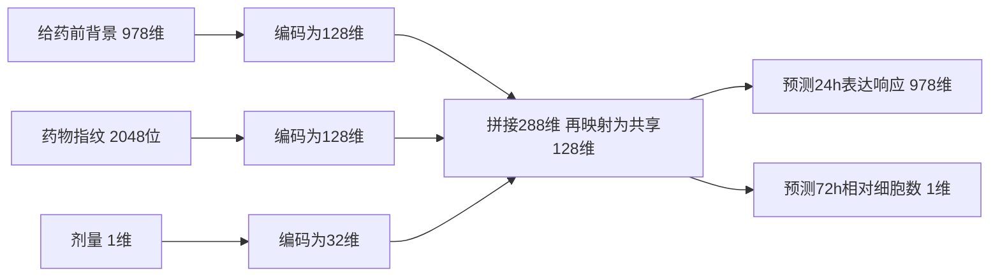

# 04 模型为什么这样设计、怎样检验

先把问题写成输入输出：

> 输入：给药前背景978维＋药物结构2048位＋剂量1个值。  
> 输出：预测24h响应978个值＋预测72h相对细胞数1个值。

推理时只给输入；实测24h响应和72h计数用于训练误差与测试评价。当前时间固定，没有把24h、72h当成两个可随意转换的同类观测。

为了知道“两类监督是否互相帮助”，必须先有各自学习的参照，再看共享和显式连接是否有用：

| 比较步骤 | 实际怎样做 | 要回答什么 |
|---|---|---|
| 简单参照 | 用训练集均值、细胞×剂量均值，以及分别拟合的岭回归 | 复杂模型是否超过总体水平或线性关系？ |
| 独立单任务网络 | 一套只学表达，另一套只学功能 | 不共享学习时，各自能做到什么？ |
| 普通联合网络 | 三类输入编码后形成共享128维表示，分头预测表达和功能 | 共同接受两类监督，是否优于单任务？ |
| 共享＋专属网络 | 为两个任务分别保留专属分支 | 强制共享是否会损失各任务需要的信息？ |
| 表达瓶颈及容量对照 | 先预测978维表达，再从预测表达预测功能；同架构另做只受功能监督的对照 | 显式表达中间层及表达监督是否增加价值？ |

普通联合的实际结构如下。它的功能分支从共享表示读取信息，表达是另一项监督；表达瓶颈变体才让功能明确经过预测表达。

训练时分别计算表达预测误差和细胞数预测误差：表达先对978个基因取平均，细胞数按训练集尺度缩放后计算误差，普通联合默认两项相加，再按条件权重汇总；验证集选停止轮次。另有两个预设任务权重变体，用于检查训练偏好。总计8种神经配置，不把结构复杂度本身当作方法贡献。架构、前向与损失均在[train.py](../src/train.py)。

## 训练划分与评价

**主要测试是新药物。** 若目的是预测没测过的药，就应把整个药物结构组留出；同药不同剂量和同条件的库板重复保持同组。五折轮流做测试，每折另设验证组，三种随机种子分别训练。它检验的是现有细胞背景中的未见药物，之后再研究未见细胞。

**次要测试是高剂量外推。** 训练只看≤1.11 μM，3.33 μM用于验证，10 μM用于测试。测试中的细胞—药物组合在训练有低剂量记录。它检验已知药物能否推到更高剂量，与新药任务分别解释。

因此训练次数为：8种配置×3个种子×（5个新药折＋1个剂量设置）＝**144次**。次数是比较设计的结果；研究价值要看下面比较回答了什么。

评价先看预测误差：细胞数MAE是平均绝对偏差，单位仍是处理/对照比值；表达MSE是978维z响应的均方误差。再看筛选效果：固定细胞与剂量，从留出药中选预测最有效的前5个，核对它们的真实细胞数，比较与真实最优前5个的差距。这样连接到“选药”这个实际落点。

## 本轮优化设置

| 设置 | 值及用途 |
|---|---|
| 优化 | AdamW，学习率0.001，weight decay 0.0001，batch 256，梯度裁剪5 |
| 停止与选择 | 最多100轮，验证15轮未改善则早停；测试不选checkpoint |
| 单任务验证指标 | 表达按表达MSE；功能按标准化功能MSE |
| 联合验证指标 | 表达MSE＋标准化功能MSE |
| 线性参照 | 岭回归alpha=1/10/100/1000，验证选择 |

完整任务表见[冻结配置](../results/frozen_training_protocol.json)，每次实际轮数与参数量见[训练记录](../results/training_runs.csv)。

---

[首页](../README.md) · ← [对接](03_integration.md) · [结果](05_results.md) →
