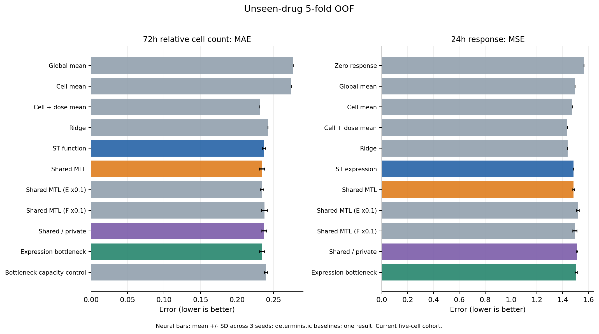

# 05 实际结果与判断

下面神经网络数值是三个种子的平均，均值基线是确定性结果；差值区间按药物整组bootstrap 2,000次计算。没有把一个示例样本的预测当成整体结果。

### 新药任务：目前还没有形成可靠的联合优势

| 方法 | 72h细胞数MAE，越低越好 | 24h表达MSE，越低越好 |
|---|---:|---:|
| 细胞×剂量均值 | **0.2313** | **1.4369** |
| 独立单任务网络 | 0.2371 | 1.4833 |
| 普通联合网络 | 0.2340 | 1.4838 |

联合相对单任务的细胞数误差降低约1.3%，但按药物分组的差值95%区间为−0.0097到＋0.0038，跨过0；而且简单均值参照的整体误差仍较低。均值能提供总体水平的强参照；模型还需要证明自己学到了有助于区分药物的差异。

所以这里的判断是：**当前新药设置下，联合收益尚未得到稳定支持。** 下一步应先分析药物差异预测、表达泛化与数据覆盖，而不是把小幅MAE变化直接写成成功。

### 高剂量外推：存在值得继续验证的改善信号

独立网络的细胞数MAE为0.1337，普通联合为0.1252，下降约6.3%；表达MSE也从1.9219降到1.8875。功能差值区间约−0.0132到−0.0037，表达差值区间约−0.0660到−0.0075。

这说明在当前五细胞、已知药物及这组剂量设置中，共同监督有帮助的信号。后续可据此检验哪些剂量段、药物或数据条件受益。该证据和新药任务一起保留；区间是本轮探索性描述，未做多重比较校正。

### 回到筛选：平均误差变化是否转成了更好的选药

新药测试的前5药物选择差距，单任务约0.2923，普通联合约0.2991，数值越小越好。**当前排序没有改善。** 因而后续改进要继续同时评价预测与选药，不能只报告一个平均误差。[排序原表](../results/metrics/ranking_by_fold_cell_dose.csv)

### 主结果以后补做的诊断：实测表达究竟有没有功能信息

联合没有稳定变好，至少有两类待区分的解释：实测表达中可能有功能相关信息，但当前模型未学好；也可能这种关系在给定任务中较弱。因此在主比较之后，另做一个诊断：**把输入换成真正测到的24h响应，用岭回归预测72h计数，并继续按同一新药划分测试。**

| 诊断输入 | 72h细胞数MAE |
|---|---:|
| 实测24h响应压成一个总体幅度值 | 0.2043 |
| 实测24h完整978维响应 | **0.1252** |

结果支持：这批实测表达与功能之间存在可利用的预测关系。完整响应优于单一幅度，值得进一步分析具体信息。诊断模型使用了药后的额外观测，和给药前预测解决的任务不同；两者差距也不能单独证明误差只来自表达预测。

**由此引出的下一问是：这些实测表达中的信息，怎样从给药前输入更可靠地预测出来，并转化为筛选收益？** 这比直接再叠一个网络模块更有明确依据。[诊断代码](../src/information_diagnostic.py)、[诊断结果](../results/information_diagnostic/metrics.csv)

完整逐种子与子集结果见[指标原表](../results/metrics/all_metrics.csv)。它们来自已经执行的实验，不是下面计划的预期结果。

---

[首页](../README.md) · ← [模型与实验](04_model.md) · [下一步](06_next.md) →
