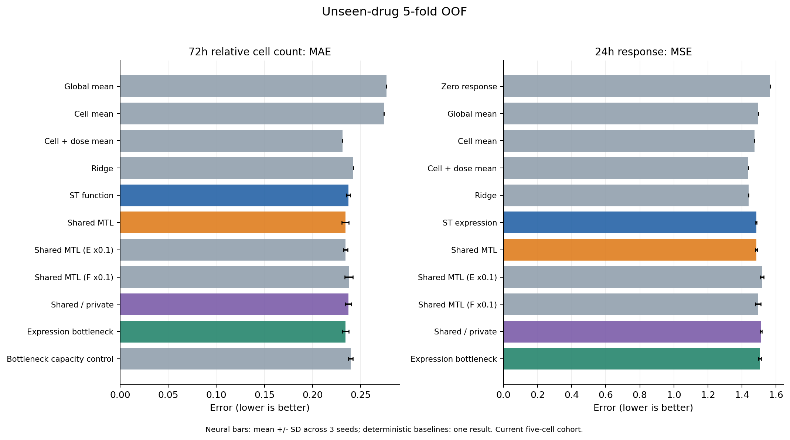
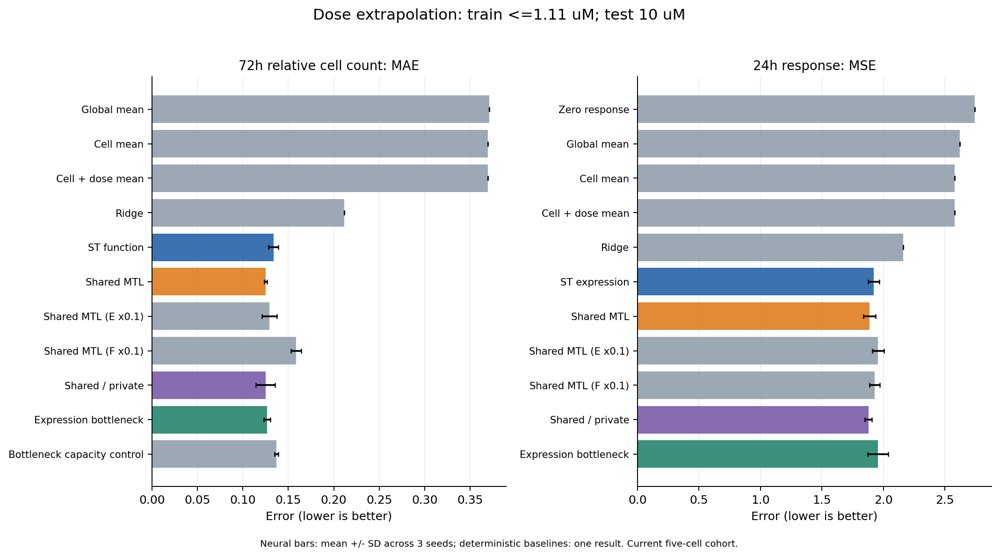
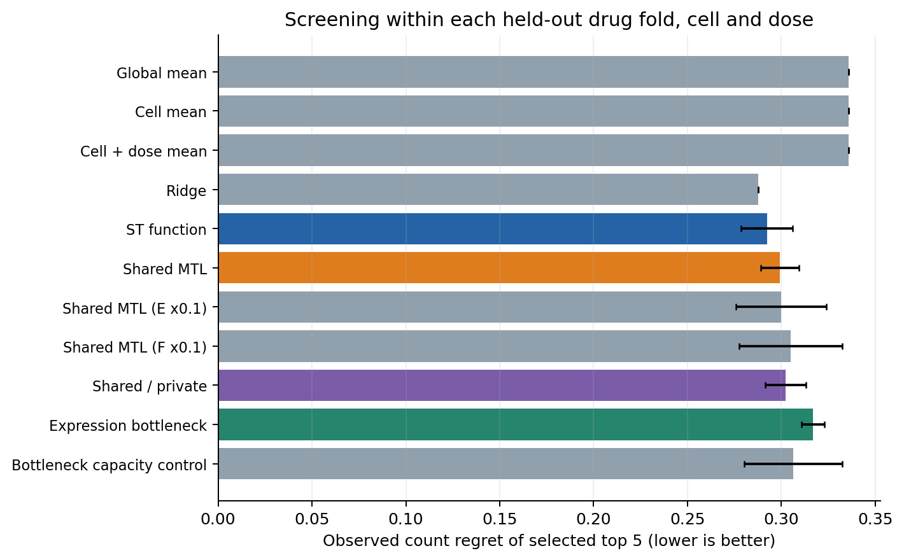
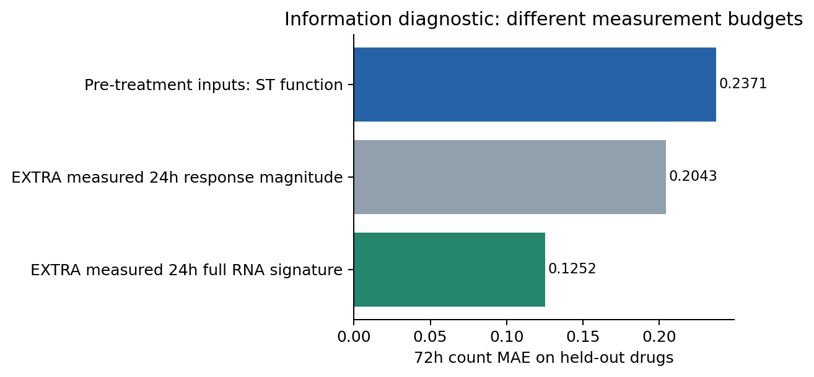

# 第一部分初步训练与探索结果

日期：2026-11-07。依据用户指定的[整体框架](../面向抗癌药物筛选的虚拟细胞建模研究.docx)第一部分。原文件保持不变。

[Word合订版：结果报告＋完整实验设计](第一部分初步训练与探索结果.docx)

## 先看结果

已经完成第一轮有对照的训练和外层评价：144个神经模型训练任务、累计4724轮；主要实验为未见药物五折、每种神经配置三个种子，另做高剂量外推。代码、权重、逐条预测、指标、排序及图均已保存。

**初步判断：新药泛化上尚未证实联合学习稳定优于单任务；高剂量外推上出现改善信号；实测24h表达包含较强的后期功能预测信息。** 这给出了继续研究的具体起点，不以已有相关论文或一次负结果否决方向。

| 我们问的问题 | 当前证据 |
|---|---|
| 表达监督能否帮助未见药物的细胞数预测？ | 普通联合MAE略低约1.3%，药物分组差值区间跨0，未显示稳定优势 |
| 联合学习在高剂量外推是否有用？ | 普通联合MAE下降约6.3%，表达误差也下降，两个预设质量子集方向一致 |
| 实测表达本身有没有功能信息？ | 额外给实测24h表达，岭回归功能MAE为0.1252；其信息预算与给药前预测不同，单列为诊断 |
| 是否已经证明真实药后/存活状态被恢复？ | 本轮验证了响应和功能预测；独立状态参考及组成子研究尚待后续，未作此结论 |

## 1 背景、问题与落点

整体框架希望建立可用于单药、跨细胞、联合及序贯筛选的基础。本轮先研究一个具体问题：**给定细胞背景、药物和剂量，表达与功能两类观测共同监督，是否比各自学习更好地预测未测药物条件，并改善药物排序？**

输入为未处理CCLE背景978维、药物结构指纹2048位、log10剂量。输出为24h L1000响应978维及72h相对细胞数1个值。功能值是Nt/Ncontrol；本轮不将它改写为死亡率。两个测量终点分别保留。

3h未进入本轮输入、监督或功能预测路径。24h在此是固定表达观察时点，不构建3h→24h轨迹。模型中间表示是否有生物学状态意义，需要后续独立参考检验。

本轮落点是可复现比较和下一步方法依据。多来源不完全配对、群体组成与存活相关状态仍属于整体第一部分，当前先完成其可追踪单药验证基础。

## 2 实际数据与入组

HMS平行计数与同项目LINCS按LJP005/006库板、细胞、药物、真实剂量连接；CCLE背景来自独立实验。先按技术孔、再按三批生物重复形成各库板功能均值，原引用继续保留。

- 24h候选3410条；不再要求3h也有数据。
- 实际核对10512条处理实例引用，读取978基因L3并检查身份、单位、剂量、24h、有限值和−666哨兵。
- 同板对照799个，覆盖32块检测板；按有效对照覆盖检查。
- 46条单实例签名不进入主比较，保留原因表。最终为**3364条库板观测、3133个不同条件、5种细胞、106种药物**。同条件多库板总权重1。
- 不按TAS或表达强弱过滤。另报告“至少三个实例”及“排除CGP-60474”两个预设敏感性子集。

这冻结的是本轮基本技术入组，不代表已经验证所有生物学状态。详见[入组流程](data/cohort_flow.csv)、[逐条QC](data/all_24h_candidates_with_QC.csv)、[来源核查](data/audit.json)。

## 3 方法怎样比较

完整架构与训练设置见[实验设计](实验设计.md)。所有主模型使用相同的给药前输入。

| 方法 | 关键区别 |
|---|---|
| 单任务 | 两套独立MLP分别学习表达和功能 |
| 普通共享联合 | 同一128维表示分别解码表达和功能 |
| 共享＋专属 | 共享、表达专属、功能专属各64维，检验保留任务信息的价值 |
| 表达瓶颈联合 | 先预测有实测目标约束的978维响应，再用这条预测响应预测功能 |
| 瓶颈容量对照 | 与上一行架构/参数完全相同，只训练功能，隔离额外表达监督 |

同时使用零响应、全局/细胞/细胞×剂量均值和独立岭回归。另预设表达或功能损失乘0.1的两个普通联合变体，所有结果保留。

优化与选型：每神经配置3个种子，最多100轮、验证早停15轮；不同任务按预定验证指标选checkpoint。联合模型两个任务损失按训练尺度平衡，功能目标的缩放只拟合训练集。未用外层测试选checkpoint。

不同结构的参数量与单任务总预算并非完全一致，参数量保存在training_runs.csv；因此不能仅凭分支有无作严格的架构因果归因。表达瓶颈与其容量对照则为完全同架构的监督比较。

## 4 主要结果：未见药物

106种药物按保守结构组整体五折留出。同一条件所有库板及重复同角色；每个药物得到一次外层测试预测。表中神经结果为三个种子的均值±标准差，基线为确定性结果。

| 方法 | 72h细胞数MAE↓ | 24h响应MSE↓ |
|---|---:|---:|
| 细胞×剂量均值 | 0.2313 | 1.4369 |
| 独立岭回归 | 0.2423 | 1.4386 |
| 独立单任务MLP | 0.2371 ± 0.0021 | 1.4833 ± 0.0035 |
| 普通共享联合模型 | 0.2340 ± 0.0036 | 1.4838 ± 0.0071 |
| 共享＋专属模型 | 0.2372 ± 0.0032 | 1.5129 ± 0.0043 |
| 表达瓶颈联合模型 | 0.2342 ± 0.0033 | 1.5031 ± 0.0089 |
| 同容量、无表达监督的瓶颈对照 | 0.2394 ± 0.0023 | — |

普通联合相对单任务的功能MAE差：**-0.0031，95%区间[-0.0097, +0.0038]**。表达MSE差：+0.0005，95%区间[-0.0183, +0.0182]。

区间按药物整组bootstrap2000次、使用三个种子的逐观测误差平均计算；是探索性描述区间，未作多重比较校正，也不包含任意新细胞或新平台的不确定性。神经种子波动与药物之间的差异是不同来源。

判断：当前普通联合的细胞数误差有小幅下降，但尚未显示稳定收益；共享/专属和表达瓶颈也没有形成双任务全面优势。细胞×剂量均值与岭回归在部分指标上更强，说明需要保留强简单基线。均值基线在同一细胞/剂量内不能区分药物，排序评价另报。



## 5 次要结果：高剂量外推

训练仅包含≤1.11μM，3.33μM用于验证选型，10μM用于测试。测试的每个细胞—药物组合均在训练中有更低剂量，区别于新药物任务。

| 方法 | 72h细胞数MAE↓ | 24h响应MSE↓ |
|---|---:|---:|
| 细胞×剂量均值 | 0.3694 | 2.5800 |
| 独立岭回归 | 0.2115 | 2.1612 |
| 独立单任务MLP | 0.1337 ± 0.0055 | 1.9219 ± 0.0463 |
| 普通共享联合模型 | 0.1252 ± 0.0016 | 1.8875 ± 0.0497 |
| 共享＋专属模型 | 0.1249 ± 0.0108 | 1.8775 ± 0.0299 |
| 表达瓶颈联合模型 | 0.1268 ± 0.0036 | 1.9537 ± 0.0839 |
| 同容量、无表达监督的瓶颈对照 | 0.1368 ± 0.0021 | — |

普通联合的功能MAE差：**-0.0085，95%区间[-0.0132, -0.0037]**；表达MSE差：-0.0344，95%区间[-0.0660, -0.0075]。

普通共享和共享/专属在该设置下有积极信号；但这是当前五种细胞、该剂量网格的一次外推设置，不据此推断任意浓度、任意平台或序贯干预都有效。其余预设变体和表达任务的负迁移同时见CSV。



## 6 药物排序有没有改善

在每个外层测试折内，固定细胞和剂量，从该折至少10种留出药中选预测细胞数最低的前5种。评价这些药的真实平均细胞数，以及相对真实最优前5种的差距（regret）。同条件库板先汇总；预测平手按随机打破的精确期望计算，避免原表顺序造成虚假优先级。

未见药物的平均top5 regret：独立功能MLP约0.2923，普通联合约0.2991，表达瓶颈约0.3167。**本轮尚未看到联合学习改善筛选排序。** 当前细胞数MAE的微小下降不能自动转换成筛选收益。

完整按折、细胞、剂量、种子的排序记录见[排序结果](results/ranking_by_fold_cell_dose.csv)。



## 7 补充探索：表达有没有可用功能信息

看到主任务的泛化差异后，单列一组补充诊断，未改动主模型或其测试结果：在相同未见药物划分下，**额外允许读取实测24h表达**，用训练/验证选择的岭回归预测72h细胞数。

| 输入信息 | 细胞数MAE |
|---|---:|
| 给药前背景＋结构＋剂量，单任务MLP | 0.2371 |
| 额外给实测24h响应的一个幅度值RMS | 0.2043 |
| 额外给实测24h的完整978维响应 | 0.1252 |

它们的信息预算不同，后一种需要实际测量24h表达，不能称为更优的给药前模型。结果支持“当前数据中实测响应与功能之间存在可利用的预测关系”；也提示应优先检验未见药物的表达预测与表示迁移，而不直接断言两类观测没有联系。该关系不证明因果机制或存活状态已被识别。

完整签名优于单一幅度的现象也提示后续应检验哪些信息超过一般响应强度；当前仅是线性诊断，仍需强通用死亡/增殖签名、分层和外部实验对照。



## 8 稳健性、已有结果和解释范围

至少三个实例及排除CGP-60474两个子集下：未见药物的普通联合小幅功能改善方向保持；高剂量外推的普通联合两任务改善方向保持。子集结果见[全部指标](results/all_metrics.csv)，不将方向一致自动称为已完成全部生物学验证。

上次调通是3/24h输入路径、验证集结果；本轮固定24h、重新入组与分组、实际外层测试。不能把两个阶段的数值直接解释成同设置下性能升降。原调通记录和原始数据保留。

当前范围：五种乳腺来源癌细胞、106药、有限剂量、同项目平行表达/计数；CCLE背景跨研究，库板存在重复和部分材料/暴露疑点。尚未完成GDSC/CTRP多来源训练、作者模型完整复现、独立外部表达测试或真实存活状态评价。本文据此报告初步结果，不虚构后续部分已完成。

岭回归在未见药物验证中均选到当前alpha网格上界1000，说明扩大正则搜索是后续应核查的优化问题；主表仍保留本轮冻结配置，不根据外层测试改写原结果。

## 9 据结果怎样继续

1. **保留共享联合模型作为可比较起点。** 它在当前高剂量外推有积极信号，在未见药物上仍需改善，不因已有先例或一轮结果直接放弃。
2. **优先检验表达泛化与数据规模。** 利用已下载的LINCS额外表达监督/预训练，设置同数据量的单任务和联合对照；按药物结构相似度、表达可靠性及功能效应分析误差。需要用新版本与独立留出验证，避免在本轮测试集反复选型。
3. **接回整体框架的数据关联研究。** 接CTRP/GDSC实际剂量功能，区分来源及终点，比较同项目、部分条件可比和未配对监督，检验额外功能数据是否真帮助表达或药物排序。
4. **推进状态参考子研究。** 单细胞组成与存活相关状态依据独立参考另做，不从本轮MAE或任意潜向量推出状态真实性。

需要比较的竞争解释包括：输入药物表示/数据覆盖不足、优化与容量选择、测量噪声及来源偏差。当前结果尚不能把某一项认定为唯一瓶颈。下一阶段据具体误差设计，而不是直接叠加复杂模块。

## 文件与复现

- [完整实验设计](实验设计.md)、[冻结配置](frozen_training_protocol.json)
- [数据和QC](data/audit.json)、[划分](data/splits.csv)、[训练清单](training_runs.csv)
- [逐种子与子集指标](results/all_metrics.csv)、[汇总表](results/seed_summary.csv)、[药物分组差值区间](results/paired_drug_bootstrap.csv)
- [分组误差](results/grouped_metrics.csv)、[按药物误差](results/per_drug_errors.csv)、[实测表达诊断](information_diagnostic/metrics.csv)
- [独立核查记录](verification.json)、[环境版本](environment.json)
- 模型权重、训练曲线、验证与外层预测按任务保存在runs；合并预测在predictions；8张图各有PNG/PDF。

在项目根目录依次运行：

```bash
python3 第一部分_初步实验_20261107/scripts/prepare.py
python3 第一部分_初步实验_20261107/scripts/train.py --verify-only
python3 第一部分_初步实验_20261107/scripts/train.py --workers 6
python3 第一部分_初步实验_20261107/scripts/baselines.py
python3 第一部分_初步实验_20261107/scripts/analyze.py
python3 第一部分_初步实验_20261107/scripts/information_diagnostic.py
python3 第一部分_初步实验_20261107/scripts/plots.py
python3 第一部分_初步实验_20261107/scripts/make_report.py
```

train会核对冻结的数据/源码指纹并跳过完整已完成任务；改变配置请另立实验版本。补充诊断为主结果之后的探索，角色和额外观测明确标记。


# 第一部分初步实验：冻结的探索设计

日期：2026-11-07。依据用户整体框架第一部分及最新授权“完整设计、训练、取得初步结果”。这是第一轮可比较的探索实验，结果用于决定后续方法，不预设联合学习或某种状态结构必然更好。

## 问题与落点

给定细胞背景、药物结构和剂量，预测24h转录响应与72h相对细胞数。检验表达监督是否帮助未见药物的功能预测、是否牺牲表达预测，以及受表达约束的中间表示对筛选排序有没有用。

24h是本轮固定表达终点，72h是独立功能终点；3h不参加本轮训练，不构造时间轨迹。群体组成/存活状态及多来源缺标签是整体第一部分的后续子研究，本轮不以任意潜向量冒充已验证的存活细胞状态。

## 数据与入组

HMS计数与同项目LINCS Phase II按实际库板、细胞、BRD药物ID、数值剂量连接。背景为CCLE独立未处理RNA；结构用已核查的Morgan指纹。功能为作者每孔Nt/Ncontrol，经库板内技术孔均值、三个生物重复等权均值形成；来源、原孔、实例与对照保留。

不要求3h可用。24h候选3410条库板记录，核对10512条处理实例引用和799个同板vehicle实例，实际读取11311×978个L3数值。基本技术入组要求：处理实例身份/剂量/时间一致、978值有限且非−666、至少两个有效表达实例、各自同板至少两个有效vehicle。所有46条排除记录均为单实例签名；没有按TAS或响应幅度过滤。

最终3364条库板观测、3133个不同条件、5细胞106药。每个跨库板同条件总权重1。将“至少三个实例”和“排除有已知跨库板疑点的CGP-60474”预设为评分敏感性子集，不据模型误差挑样本。基本技术入组不等于全面生物状态验证。

## 模型与输入输出

输入：CCLE978维、结构2048位、log10剂量1维。细胞/剂量缩放参数只在训练集拟合；结构保持二进制。药后真实表达和真实功能均不作主模型输入。

| 模型 | 结构/训练 | 回答的问题 |
|---|---|---|
| 零响应、训练均值、细胞均值、细胞×剂量均值 | 只用训练标签形成基线，未见键按预定规则回退 | 是否超越简单水平和分组均值 |
| 独立岭回归 | 表达和功能各自选择正则参数 | 线性基线 |
| expr_only / func_only | 独立MLP，共同输入，分别只训练一个目标 | 单任务非线性起点 |
| joint_shared | 共用编码/128维表示，表达和功能并行解码 | 普通多任务是否互助 |
| joint_shared_E01 / F01 | 分别将表达或功能训练损失权重降至0.1，验证选择仍按未加该偏好的平衡误差 | 初步观察任务权重和负迁移 |
| joint_private | 共享64、表达专属64、功能专属64，拼接成各任务128维输入 | 任务专属分支是否有用，不预先认定其生物学含义 |
| joint_bottleneck | 先预测978维24h响应，再从该预测响应预测功能 | 显式表达约束的中间表示是否有价值 |
| function_bottleneck_control | 与joint_bottleneck同架构，只训练功能，不加真实表达监督 | 隔离架构容量与表达监督的作用 |

基础编码：细胞978→128、药物2048→128、剂量1→32，拼接288→128；GELU、融合后LayerNorm及0.1 dropout。表达头输出978个实数；直接功能头128→64→1，表达瓶颈功能头978→64→1。保存每模型实际参数量；共享/专属与普通共享的容量不是完全相同，结果不单凭这些比较作架构因果归因。

表达损失先对978基因平均；功能在训练集均值/标准差尺度计算MSE；按条件权重求均值。默认两任务等权，两个预设权重变体单列报告。表达单任务按验证表达MSE、功能单任务按验证功能MSE、联合模型按验证表达MSE＋标准化功能MSE选checkpoint，不用测试数据选模型。

## 划分、训练与评价

- 主要实验：保守化学连接结构整体分五组，每折一组测试、下一组验证，其余训练。相同条件的全部库板/重复同角色。
- 剂量外推：10μM测试、3.33μM验证，较低剂量训练；与新药泛化分别解释。
- 预生成骨架划分留待后续，本轮不声称已完成该实验。
- 每神经配置三个种子20261107/08/09；最多100轮，早停耐心15轮，batch256，AdamW lr0.001、weight_decay0.0001，梯度裁剪5。总计144个神经模型训练任务，另有岭回归与无需训练的基线。
- 岭回归alpha为1/10/100/1000，只按验证误差选择。利用训练特征张成的正交子空间求解，核对训练特征重建误差，保留原岭回归的训练行空间信息。
- 基础验证、来源与配置先固定，再训练和评分。以前有一个不同3/24h结构的调通实验，本轮为有明确比较的探索性验证，不称未受任何探索影响的确认性试验。

主指标：72h比例原尺度MAE和24h响应MSE。补充RMSE、R²、表达逐条件相关、按细胞/剂量/药物分组误差。每条件按库板权重合计1；同时给不同条件平均标签上的敏感性评分。

筛选：在固定细胞与剂量的测试药物中，按预测细胞数从小到大选前5个，报告其真实平均细胞数、相对真实最优前5个的遗憾和重合率。每个分组至少10种药，先合并同条件的库板观测；不把不同剂量当同一次筛选。

五折拼成每药一次外层测试的预测，三种子分别及均值集成均报告。模型差值按药物整组bootstrap2000次给描述性95%区间，明确只覆盖当前五种细胞和剂量范围。测试结果用于本轮结论；后续改模型另存版本，不把测试选优写成验证选优。

## 交付和后续

保存数据入组表、实例/vehicle检查、划分、源码/输入指纹、全部训练曲线、checkpoint、验证及外层预测、指标、分组误差、排序和图。结果报告包含收益与负迁移，区分初步功能/表达预测与独立状态真实性验证。

后续据本轮误差进入：多来源条件关联/缺标签学习；单细胞组成与状态参考；必要的表示约束或更复杂模型。已有文献作为继承和比较基础，相关工作重合不自动终止研究。
