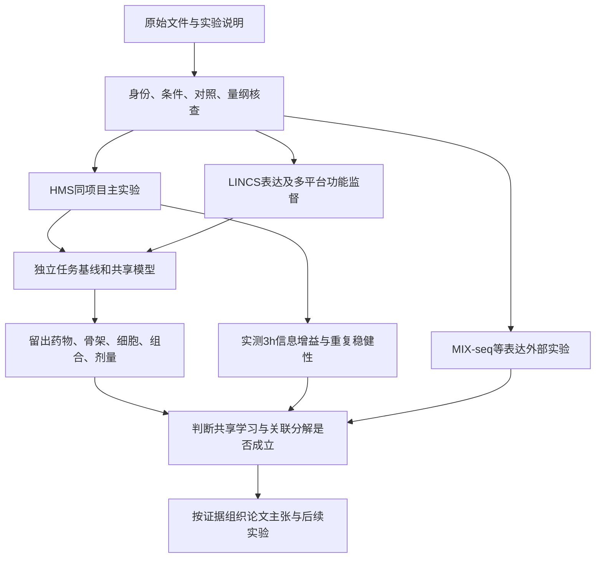

# 单药干预下表达响应与细胞功能：项目总设计

最新初步比较见[2026-11-07训练与探索结果](../第一部分_初步实验_20261107/README.md)：24h表达与72h功能、144个神经训练任务及基线/排序/诊断。下面的设计与调通记录按各自版本阅读，不再以“未评分外层测试”描述当前进展。

最新依据为用户指定的[整体框架](../面向抗癌药物筛选的虚拟细胞建模研究.docx)，现行实施见[第一部分设计与实际起步](../第一部分_依据整体框架的设计与起步_20261106/第一部分设计与起步说明.md)。已有相关工作用于确定继承、对照及证据增量，不自动否决方案或将主候选降级。

本目录保留此前[输入输出说明](先看这份_输入输出架构与论文主线.md)及[18项相关工作](相关工作与创新性复核_20261106/文献梳理与方案判断.md)，数据含义及来源核查继续沿用；具体起步结构以新框架对应的实施说明为准。

版本：2026-11-06。此目录原版依据《初步方案.md》、`1.png`、本地数据、核查脚本及文献；现已接入用户指定整体框架。整体框架不等同于已有完整结果正文，NC具体指代/稿件意见仍未确认，期刊部分暂按Nature Communications列可核查规范。

## 现在这个项目具体研究什么

核心问题是：**给定一种细胞背景、一种药物及其剂量，能否同时预测早期基因表达响应和后期细胞功能；两类监督是否互相帮助，在哪些条件下会出现分歧？**

表达响应描述药物处理后基因表达怎样改变。功能描述实验实际测得的细胞数量、ATP信号或条形码相对丰度。它们有联系，但测量对象不同。HMS主实验预测的是72h相对细胞数，后续扩展分别预测各平台自己的读数。

本项目按四个可检验问题组织：

1. 用给药前可获得的信息，同时预测3h/24h表达响应和72h相对细胞数，共享模型是否优于分别训练？
2. 如果额外测一次3h表达，对24h表达和72h功能预测能增加多少信息？
3. 表达中与后期功能相关的部分，以及其余表达变化，能否在留出药物和细胞中保持可重复的关联？
4. 引入更多细胞、药物和实验平台后，上述结论能否保持，哪些差异需要平台专属处理？

这些问题分别对应联合预测、早期实测价值、关联分解和跨实验泛化。单药数据为长期状态转移研究提供起点；序贯给药、组合及策略优化另需对应实验轨迹支持。

## 先用哪些数据，分别承担什么工作

| 实验层 | 参与数据 | 实际观测及用途 | 本轮完成层级 |
|---|---|---|---|
| 主实验 | HMS计数＋同项目LINCS Phase II＋CCLE背景＋药物结构 | 按同库板、细胞、药物、剂量连接3h/24h响应与72h计数；检验双任务和早期信息价值 | 数值提取、来源核对、实验准备包、划分草案已完成；生物学入组规则待定稿 |
| 扩展实验 | LINCS Phase I/II＋CTRP，后续加入GDSC、PRISM | 扩大表达和功能各自的监督；对实际可对应条件做跨平台比较 | CTRP实测剂量对应关系已生成；GDSC/PRISM实际文件已检查，尚未完成统一训练表 |
| 表达外部实验 | MIX-seq、sci-Plex、NCI TPW、DRUG-seq；Tahoe先作格式试验 | 检验表达方向、时间和跨平台迁移；单细胞数据检验群体分布 | 已下载并检查实际内容；尚未完成统一表达处理及外部评分 |
| 背景补充 | MCF10A独立RNA-seq和同平台vehicle | 扩展第六种细胞，并比较背景定义 | 4个RNA-seq对照已下载、转录本汇总；295个vehicle表达已提取；培养和基因映射复核继续 |

原计划78个文件已全部下载，压缩原文件约102.71 GB；这个完成率只指下载清单。Tahoe当前仅下载1/3388个表达分片。Phase I大矩阵已下载，仍是压缩文件；扩展路线的全部数值矩阵尚未提取。

## 主实验现在到底有什么

当前实验准备包包含5种细胞、106个药物ID、530个细胞—药物组合、3,168个不同剂量条件。细胞为BT20、HS578T、MCF7、MDAMB231、SKBR3。

保留库板后有3,407条观测记录，每条包括：

- 一条CCLE细胞背景向量，978个基因；这是独立实验中的未处理背景。
- 一种药物的原始结构、标准化结构和2048位指纹。
- 一个μM剂量，实际有0.04、0.12、0.37、1.11、3.33、10六档。
- 两条实际L1000响应向量，分别为3h和24h，每条978维z分数。
- 一个72h相对细胞数，以及三个生物重复的汇总值、技术孔引用和库板标识。

本轮已生成`expression_z[3407,2,978]`、背景`[5,978]`、指纹`[106,2048]`及功能标签。3,407条记录对应3,168个条件，是因为239个条件在两个库板中均有观测；两库板的表达与功能各自保留，每个条件总权重为1。

106个药物ID经本轮结构审计也对应106个保守连接结构组、105个Murcko骨架组。核心功能部分保留10,221条库板内生物重复记录，追溯30,321条技术孔。它们均不等于独立药物数或独立细胞数。

## 用一条真实记录理解全过程

例如BT20＋afatinib＋0.04 μM：

| 部分 | 记录 |
|---|---|
| 细胞 | BT20，DepMap `ACH-000536` |
| 药物 | afatinib，`BRD-A58767537` |
| 库板 | `LJP006` |
| 3h表达 | `LJP006_BT20_3H:G24`，读取978个实测landmark的L5响应z分数 |
| 24h表达 | `LJP006_BT20_24H:G24`，同样按基因ID读取 |
| 72h功能 | 三批库板内技术孔均值为0.722953、0.768253、0.762517；等权平均0.751241 |

0.751241表示处理后终点细胞数约为DMSO对照的75.1%。它本身不提供死亡比例；同一相对数量可以由增长减慢、死亡或二者共同造成。HMS的初始计数可进一步计算相对净增长，帮助区分数量与增长变化。

此处的“连接”是有来源证据的平行实验条件对应：相同项目库板、细胞、药物和剂量，表达与功能终点分别保留。它不是追踪同一个细胞从3h活到72h。详见[完整实例](../data/integration_20261106/BT20_afatinib_0.04uM实例/逐步说明.md)。

## 整个研究怎样推进

第一阶段先形成可复现的数据基准和强基线。第二阶段只在同一划分、同样输入、同样数据预算下比较双任务、串联和共享/专属模型。第三阶段加入异构数据，并锁定外部实验检验迁移。JEPA、时间转移和单细胞分布模型按所回答的问题逐项加入。

我的判断是：这个方向具备具体可执行的数据基础；研究贡献应落在“什么条件下表达与功能能互补、什么条件下失配，如何用实验和严格泛化检验证明”上。双输出、注意力、JEPA或信息分解的名称本身不足以证明贡献，相关思路已有文献覆盖。若某模块没有可重复收益，就保留简单模型和负结果，调整相应主张。

## 阅读顺序与交付文件

| 文件 | 解决的问题 |
|---|---|
| [数据清点 data_audit.md](data_audit.md) | 各数据从哪来、测什么、能做什么、现在整理到哪一步 |
| [对接设计 integration_design.md](integration_design.md) | 真实记录如何连接，如何处理剂量、时间、身份、重复和尺度 |
| [模型设计 model_design.md](model_design.md) | 输入、目标、损失、共享/专属、JEPA、时间模型如何定义 |
| [实验方案 experiment_plan.md](experiment_plan.md) | 假设、基线、划分、指标、统计、外部验证、执行顺序 |
| [文献与报告规范 literature_and_reporting.md](literature_and_reporting.md) | 最接近工作实际怎样对接，项目差异如何检验，期刊规范来源 |
| [数据注册表 dataset_registry.csv](dataset_registry.csv) | 机器可读的数据来源、用途和完成层级 |
| [主张与证据 claims_evidence.csv](claims_evidence.csv) | 原始想法对应哪些事实、实验和目前证据状态 |
| [待查问题 issue_register.csv](issue_register.csv) | 具体异常、已查明什么、下一步如何查 |
| [实际文件清单 file_inventory.csv](file_inventory.csv) | 78个下载文件的来源、记录状态、磁盘大小复核 |
| [实验准备包说明](../data/prepared_20261106/HMS_v3_实验准备/README.md) | 矩阵、字段、划分草案和重新生成方法 |

原始方案、原文件和v1/v2产物均保留。正式正文提供后，应将正文具体主张逐项接入主张—证据表；本设计不预设未经提供的正文已经证明了任何结果。

v3数据准备阶段模型训练数为0。此后已依据用户整体框架完成[1次联合模型调通训练/验证](../第一部分_依据整体框架的设计与起步_20261106/联合模型调通试验/run_summary.json)；外层测试未评分、生物学QC与完整方法比较未完成，尚未形成方法优越性或状态真实性结论。

本轮原孔追查见[CGP-60474跨库板差异](../data/investigation_20261106/CGP60474_跨库板差异/说明.md)。便于整体阅读的[Word合订本](项目整体设计与数据对接_20261106.docx)与本目录六份主文档同步生成。
